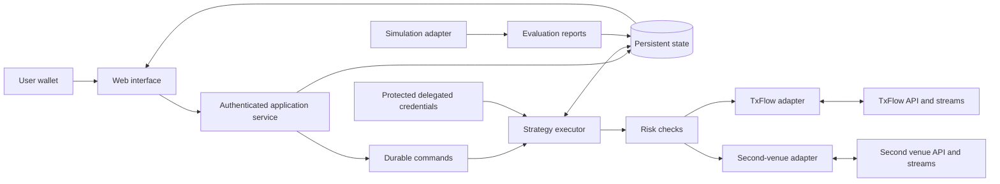

# Proposed system architecture

Technology choices are provisional until a working integration validates them. A TypeScript web interface and application service are proposed; the execution adapter may use another language if supported libraries warrant it.

## Responsibilities

Web: configuration, permission review, reports, and controls. Application service: wallet-session authentication, authorization, validation, user isolation, and command acceptance. Executor: two-leg state transitions, deadlines, bounded retries, one-sided-fill handling, and recovery. Risk checks: entry validation, the minimum-edge gate, delta and per-venue margin monitoring, early-close rules. Adapters: one per venue; venue-specific transport, signing, metadata, and reconciliation. Evaluation engine: strategy execution against an explicitly defined simulation model, sharing the cost model and the edge gate with the executor.

The executor must be independent of browser lifetime and short-lived request handlers. Only one executor may act on a strategy at a time; durable ownership with fencing must prevent a stale worker from submitting competing actions.

## Internal adapter contract

Capabilities include reading instruments, market snapshots, positions, open orders and fills; submitting/cancelling orders; and subscribing to updates. Capability flags describe supported order types, client identifiers, reduction semantics, environments, and permissions. These are proposed internal interfaces, not invented venue API endpoints.

Preserve decimal precision and unit metadata. Translate venue data into normalized records while retaining sanitized originals for diagnostics. Validate the exact schema and signing implementation against official examples and tests.

## TxFlow facts the adapter relies on (reviewed 23 October 2026)

Mainnet `https://rpc.txflow.com`, testnet `https://rpc.txflow-testnet.xyz`; one host serves `/info`, `/exchange`, `/ws`, `/api-ws`, `/ws-rtds` and, on testnet, the faucet. EIP-712 domain names `TxFlow-Mainnet` / `TxFlow-Testnet`, chain IDs 869 / 2511, signing `apiVersion` 1, request header `x-api-version: 2026-08-16`. Reads are unauthenticated; writes are signed by the user's wallet (setup, funds) or an agent key (trading). Prices and sizes are strings. Instrument precision, tick and maximum leverage come from `perpMeta`; funding and open interest from `activeAssetCtx`. Mainnet writes are subject to TxFlow's limited-access phase. These must be re-verified at implementation time.

## Builder Code handling

If a builder fee is used, each TxFlow `order` action carries an action-level `builder { b, f }` covered by the signature, with `f` in tenths of a basis point and within the per-market cap (100 for perpetuals). The user approves a cap with `approveBuilderFee` signed by their main key; an agent cannot grant it. TxFlow silently ignores an absent, unapproved or over-cap fee, so the executor records the cap it requested from each user and must not treat the fee as collected without reading the builder's own state (`builderState`; `claimBuilderRewards` is agent-signed). The builder address needs at least 100 USDC in its perp account for fees to accrue. The fee is added to the user's exchange fee, so evaluation, review and reports show the sum.

## Minimum-edge gate

The risk layer computes expected carry from the funding rates visible at entry on both venues, the notional and the configured hold, and compares it with round-trip costs: exchange fees on four fills, any builder fee on the two TxFlow fills, and estimated slippage. The cycle opens only if carry is at least the configured multiple of costs. The same function is used by the evaluator and the executor so the prototype and the product cannot disagree. Every refusal is stored as an audit event with the numbers used.

## Data model

| Record | Purpose |
|---|---|
| User / wallet session | Authenticated owner and expiring session |
| Exchange connection | Account, environment, permission state, secret reference (one per venue) |
| Builder approval record | Cap requested from each user, approval check result, fee actually charged |
| Strategy version | Immutable rules, limits, and parameter changes |
| Evaluation run | Data source, period, assumptions, version, metrics |
| Bot / cycle | Current state, `protected_at`, scheduled close, ownership, repeat setting, per-leg status |
| Edge-gate decision | Inputs (rates, notional, hold, costs), result, reason |
| Order intention / venue order | Durable request identity and observed outcome |
| Fill / funding / fee | Deduplicated source events for accounting |
| Incident / audit event | Reasons for actions, failures, and user controls |

Write intentions durably before submission. Use idempotent commands and source-event deduplication; do not claim exactly-once delivery across remote systems. The observed venue state must be reconciled after uncertain responses and restarts.

## Account security

Never request the primary wallet key or seed phrase. Use delegated credentials where supported, stored encrypted with key management separate from application records. Restrict worker access, redact logs, and isolate users in every read and command.

Authenticate wallet sessions with domain-bound, expiring, single-use challenges. Verify ownership server-side. Authorization to view or control a bot must not depend on client-supplied user identifiers alone.

Audit the complete delegated permission scope. Do not assume all agent actions are limited to order placement. User-configured software limits are not on-chain guarantees. Credential compromise remains a trading risk even when withdrawals are unavailable.

## Operating requirements

Aggregate rate limits across users sharing an IP (TxFlow's `/info` and `/exchange` limits are per IP). Prefer shared public streams and cached metadata; separate private routing and access checks. Monitor freshness, queue lag, unresolved orders, worker health, permission failures, and reconciliation latency. Back up durable state and test restoration before invited users.

Optional notifications are downstream of durable events; delivery failure must not stall risk monitoring. Webhooks are not required to confirm fills. No alert channels are connected by this documentation.
