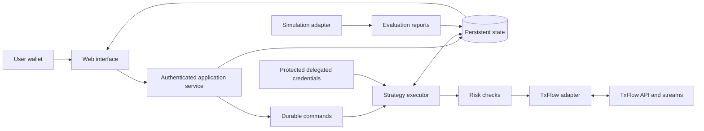

# Proposed system architecture

Technology choices are provisional until a working integration validates them. A TypeScript web interface and application service are proposed; the execution adapter may use another language if supported libraries warrant it.

## Responsibilities

Web: configuration, permission review, reports, and controls. Application service: wallet-session authentication, authorization, validation, user isolation, and command acceptance. Executor: state transitions, deadlines, bounded retries, and recovery. Adapter: venue-specific transport, signing, metadata, and reconciliation. Evaluation engine: strategy execution against an explicitly defined simulation model.

The executor must be independent of browser lifetime and short-lived request handlers. Only one executor may act on a strategy at a time; durable ownership with fencing must prevent a stale worker from submitting competing actions.

## Internal adapter contract

Capabilities include reading instruments, market snapshots, positions, open orders and fills; submitting/cancelling orders; and subscribing to updates. Capability flags describe supported order types, client identifiers, reduction semantics, environments, and permissions. These are proposed internal interfaces, not invented venue API endpoints.

Preserve decimal precision and unit metadata. Translate venue data into normalized records while retaining sanitized originals for diagnostics. Validate the exact schema and signing implementation against official examples and tests.

## Data model

| Record | Purpose |
|---|---|
| User / wallet session | Authenticated owner and expiring session |
| Exchange connection | Account, environment, permission state, secret reference |
| Strategy version | Immutable rules, limits, and parameter changes |
| Evaluation run | Data source, period, assumptions, version, metrics |
| Bot / cycle | Current state, deadline, ownership, repeat setting |
| Order intention / venue order | Durable request identity and observed outcome |
| Fill / funding / fee | Deduplicated source events for accounting |
| Incident / audit event | Reasons for actions, failures, and user controls |

Write intentions durably before submission. Use idempotent commands and source-event deduplication; do not claim exactly-once delivery across remote systems. The observed venue state must be reconciled after uncertain responses and restarts.

## Account security

Never request the primary wallet key or seed phrase. Use delegated credentials where supported, stored encrypted with key management separate from application records. Restrict worker access, redact logs, and isolate users in every read and command.

Authenticate wallet sessions with domain-bound, expiring, single-use challenges. Verify ownership server-side. Authorization to view or control a bot must not depend on client-supplied user identifiers alone.

Audit the complete delegated permission scope. Do not assume all agent actions are limited to order placement. User-configured software limits are not on-chain guarantees. Credential compromise remains a trading risk even when withdrawals are unavailable.

## Operating requirements

Aggregate rate limits across users sharing an IP. Prefer shared public streams and cached metadata; separate private routing and access checks. Monitor freshness, queue lag, unresolved orders, worker health, permission failures, and reconciliation latency. Back up durable state and test restoration before invited users.

Optional notifications are downstream of durable events; delivery failure must not stall risk monitoring. Webhooks are not required to confirm fills. No alert channels are connected by this documentation.
