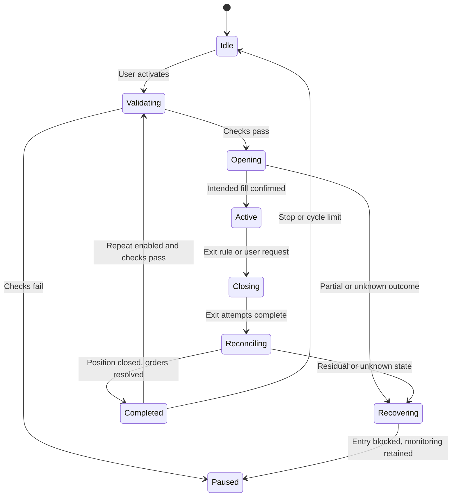

# Initial bot behavior

This is a behavioral specification, not implemented functionality or a recommended trading strategy.

## Configuration

Required before activation: venue account, instrument, long/short direction, entry condition, position-size cap, margin mode, leverage limit, exit conditions, maximum holding duration, stale-data threshold, loss limit, and execution/slippage limits. Values must satisfy current venue rules and be explicitly reviewed by the user.

Entry modes for the first implementation: explicit user-triggered entry or a simple price condition. Technical-indicator strategies are outside the first release. There is no random direction selection or automatic increase in position size after a loss.

## Cycle lifecycle

The diagram simplifies recovery transitions; the executor must persist outstanding orders, fills, and incidents rather than infer a flat account from the state name.

## Opening and timing

Validate market metadata, available margin, permissions, current position, data freshness, and limits before submitting an order. Persist the intention first. Acceptance is not a fill.

Record the first confirmed fill time; this starts the maximum holding timer, preventing partial positions from escaping the deadline. The opening attempt also has its own timeout. Remaining quantity must be cancelled or reconciled before declaring the position fully active. Partial fills may enter bounded recovery, including reduction of the filled position, according to an explicit policy.

Persist the original close deadline in UTC. A restart must not reset it. If a restart occurs after the deadline, reconcile first and prioritize the outstanding exit. Five and twelve hours are supported planning examples, not mandatory defaults.

The future delta-neutral module uses a different timer anchor—confirmed protection of both legs—and separately limits exposure before that anchor. See the earlier hedged-cycle research for that module.

## Exit and repetition

Exit can be requested by the user, duration limit, configured price condition, or risk rule. Cancel relevant pending entries, refresh the actual position, and submit a bounded reduction using validated venue semantics. An exit request cannot guarantee immediate liquidity or execution during an outage.

A cycle completes only after position and order reconciliation. Residual amounts below venue minimums require explicit handling and prevent automatic repetition unless a reviewed residual policy allows it. Never silently label them closed.

Repeat only when the previous cycle is resolved, the user still authorizes repetition, and the full entry checks pass again. Optional cooldown and cycle-count limit are configuration fields. Time-based turnover is not evidence of economic benefit.

## User controls

| Control | Behavior |
|---|---|
| Pause new entries | Block entries and repetition; continue monitoring and configured exit handling |
| Stop after current cycle | Complete existing management; do not start another cycle |
| Cancel pending orders | Cancel this strategy's pending orders; positions may remain |
| Close position | Request a reconciled exit; show pending/partial/failure status |
| Revoke trading authorization | Prevent future authorized actions once effective; existing positions still require attention |

## Failure rules

Unknown order outcome: query orders/fills before retrying. Duplicate events: deduplicate by stable source identifiers. Stale market data: block new exposure and mark the incident. Unexpected manual position changes: reconcile and suspend new entries. Authorization failure: stop new writes and expose the reason. Platform outage: retain state and retry within bounds; never fabricate successful closure.

