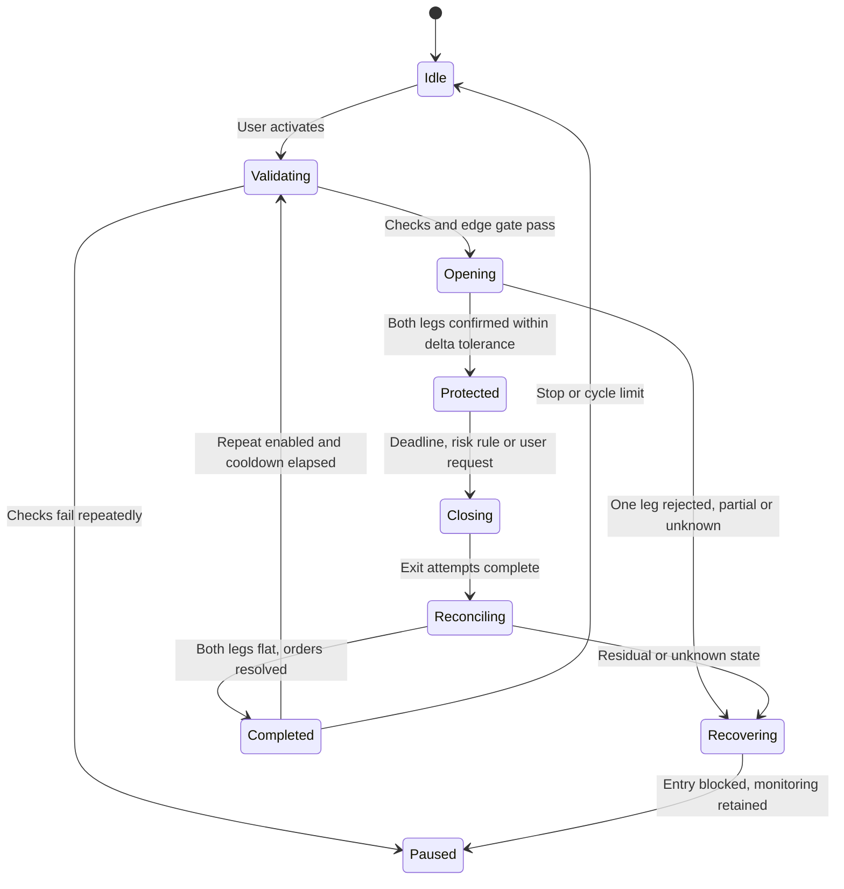

# Initial bot behavior

This is a behavioral specification, not implemented functionality or a recommended trading strategy.

## Configuration

Required before activation: the two venues and an instrument on each, direction per venue (long on one, short on the other, chosen by the user), a common executable size within lot rules, margin mode and leverage per venue, hold duration, delta tolerance, maximum entry basis, maximum unhedged window, slippage limit, stale-data threshold, loss limit, and the minimum-edge gate (enabled, with a required carry-to-cost multiple). Optional: repetition with cooldown and a cycle limit; a builder fee if one is introduced. Values must satisfy current venue rules and be explicitly reviewed.

There is no random direction selection, no automatic direction switching, and no increase in size after a loss. If no common executable size exists within the delta tolerance, the cycle does not open.

## Entry checks

Validate permissions on both venues, instrument metadata, margin on each venue, current positions, data freshness, entry basis against the limit, and limits. Then apply the **minimum-edge gate**: expected carry = notional × (funding rate paid to the short leg's venue − funding rate paid by the long leg's venue) × hold, using the rates visible at entry. Entry proceeds only if that carry is at least the configured multiple of round-trip costs (exchange fees on four fills, any builder fee on the two TxFlow fills, estimated slippage). Otherwise the bot refuses, records why, takes no exposure, and re-checks later. Funding can change during the hold; the gate is a filter, not a forecast.

## Cycle lifecycle

The diagram simplifies recovery. The executor must persist outstanding orders, fills and incidents on both venues rather than infer a flat account from the state name.

## Opening and timing

Persist an intention for each leg before sending anything. Acceptance is not a fill: fills are read from venue data. Track the unhedged window from the first confirmed fill. If the second leg is not confirmed within that window, or is rejected, query orders and fills first (no blind resubmission), then unwind the filled leg within the slippage limit and escalate if that fails. Never start a new cycle with unknown exposure.

The hold timer starts at `protected_at`, the moment **both legs are confirmed** within the delta tolerance, and `scheduled_close_at = protected_at + hold`. It does not start at the click or at the first fill. Both are persisted in UTC and a restart must not reset them. If a restart occurs after the deadline, reconcile first and prioritize the exit. Five and twelve hours are configurable examples, not mandatory defaults.

## Monitoring while protected

Track net delta, margin health on each venue separately, funding accrual, data freshness and incidents. Margin is held per venue: profit on one leg cannot rescue the other leg's margin, so the winning leg's venue does not protect the losing leg from liquidation. Configurable risk rules close both legs early: margin health below a threshold on either venue, the loss limit, and persistent staleness. If net delta leaves the tolerance, the bot proposes a rebalance and, in the pilot, waits for the user's approval rather than acting alone.

## Exit and repetition

Exit can be requested by the user, the duration limit, or a risk rule. Cancel the cycle's pending orders, read actual positions on both venues, and submit bounded reductions using validated venue semantics. An exit request cannot guarantee immediate liquidity or execution during an outage. If one venue is unavailable, retry within bounds, keep the exposure visible, and never mark the cycle complete.

A cycle completes only after both venues' positions and orders are reconciled. Residual amounts below venue minimums require explicit handling and block automatic repetition unless a reviewed residual policy allows it.

Repeat only when the previous cycle is resolved, the user still authorizes repetition, and the full entry checks, **including the edge gate**, pass again. Cooldown and a cycle limit are configuration fields. Time-based turnover is not evidence of economic benefit.

## User controls

| Control | Behavior |
|---|---|
| Pause new entries | Block entries and repetition; continue monitoring and configured exit handling |
| Stop after current cycle | Complete existing management; do not start another cycle |
| Cancel pending orders | Cancel this cycle's pending orders; positions may remain open |
| Close both legs | Request a reconciled exit on both venues; show pending/partial/failure status |
| Revoke trading authorization | Prevent future authorized actions once effective; open positions still require attention |

## Failure rules

Unknown order outcome: query orders and fills before retrying. Duplicate events: deduplicate by stable source identifiers. Second leg rejected: unwind per policy, then pause. Stale data on either venue: block new exposure and mark the incident; show values as stale, never as zero. Unexpected manual position change: reconcile and suspend new entries. Authorization failure: stop new writes and expose the reason. Venue outage: retain state and retry within bounds; never fabricate successful closure. Builder fee approval absent or revoked: TxFlow ignores the fee without rejecting the order, so the bot must not assume the fee was collected.
